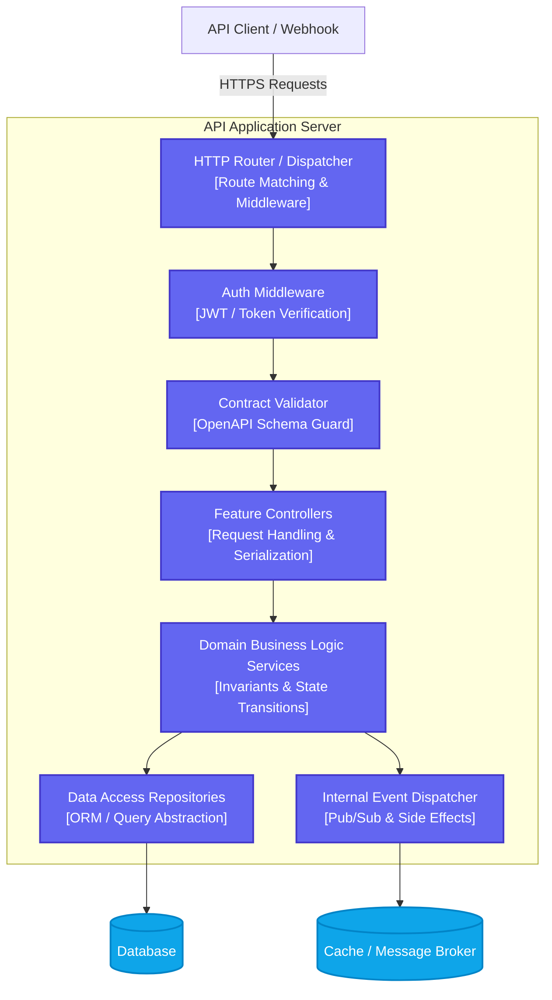

# C4 Component Diagram

> Level 3 C4 diagram describing the structural components within the API Application Server container.

## Component Breakdown
1. **HTTP Router / Dispatcher:** Ingests inbound requests, maps URIs to handlers, and orchestrates middleware chains.
2. **Auth Middleware:** Verifies identity tokens, enforces RBAC/ABAC authorization rules, and rejects unauthenticated callers.
3. **Contract Validator:** Enforces schema integrity strictly against `docs/api/openapi.yaml` before executing business logic.
4. **Feature Controllers:** Translates HTTP payloads into domain parameters and formats standardized HTTP responses.
5. **Domain Business Logic Services:** Encapsulates core system invariants, state machines, and business rules.
6. **Data Access Repositories:** Isolates SQL/database operations behind typed repository contracts.
7. **Internal Event Dispatcher:** Coordinates asynchronous side effects, cache invalidations, and audit logging.
