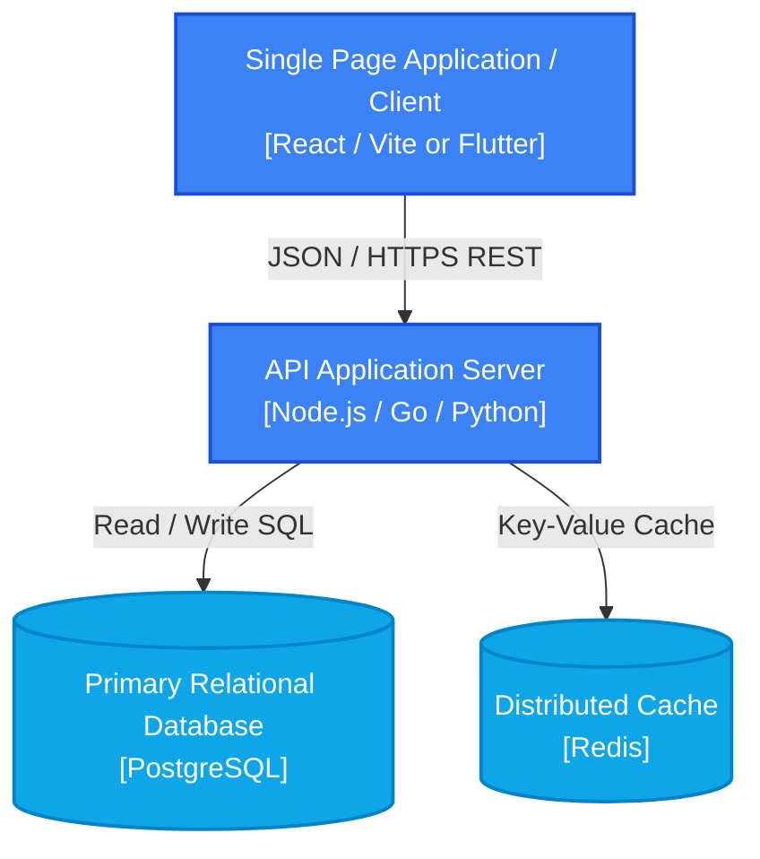

# C4 Container Diagram

> Level 2 C4 diagram describing the deployable units (applications, datastores, queues) that make up the system.

## Containers Description
1. **Client SPA / Mobile App:** Renders user interface, enforces design tokens, client-side routing.
2. **API Application Server:** Handles business logic, validates API contracts against `docs/api/openapi.yaml`, enforces security.
3. **Database:** ACID compliant persistent storage.
4. **Cache:** Sub-millisecond session state and high-frequency read cache.
