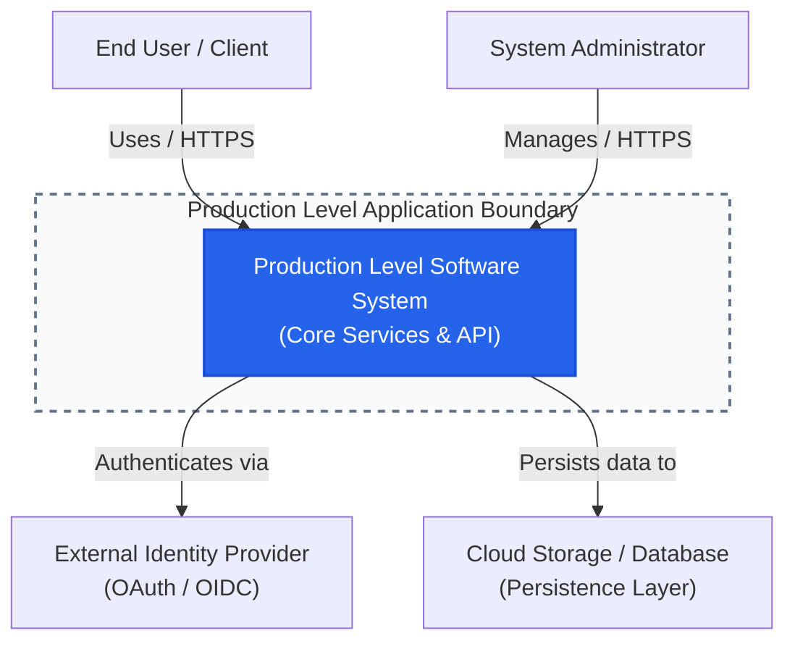

# C4 System Context

> Level 1 C4 diagram describing the system boundaries, users, and external integrations.

## Key Invariants
- All client communication must occur over TLS (HTTPS/WSS).
- User requests must be authenticated at the edge before hitting core domain services.
